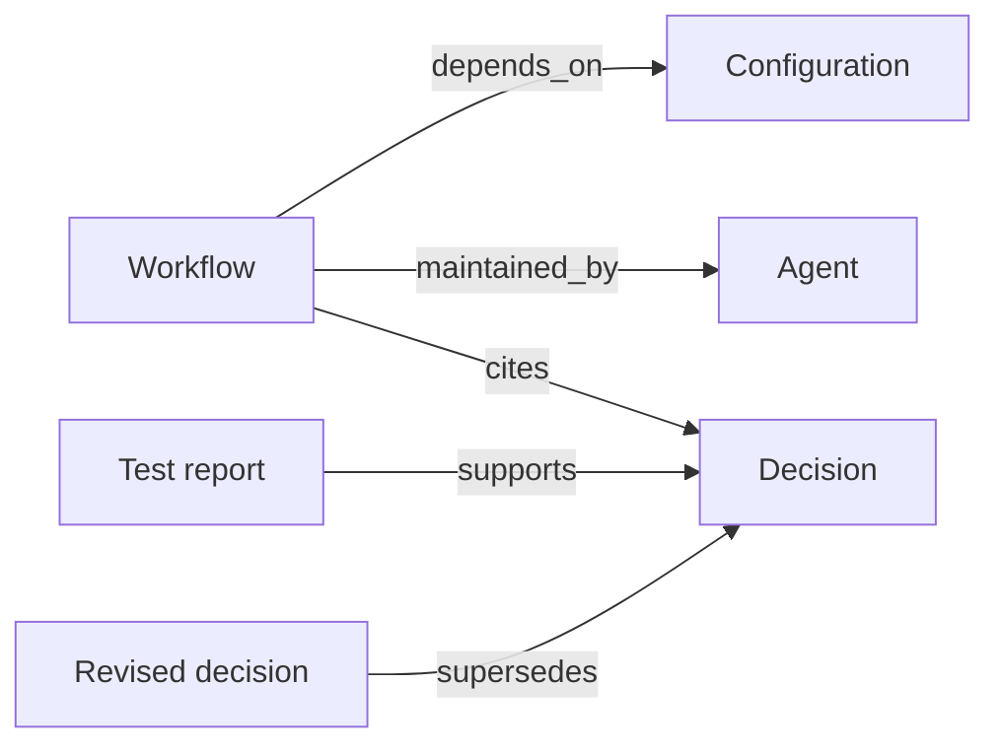
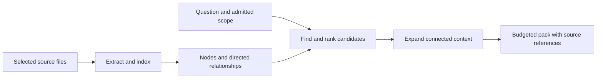

<picture>
  
</picture>

# Arcturion Brain

**Connected context for people and agents.**

Arcturion Brain turns a collection of files into a navigable knowledge graph. It indexes records, preserves their relationships and assembles a focused, source-linked context pack for a question. The aim is practical: help the agent doing the work recover the decisions, dependencies and evidence that belong with it.

Built within the [Arcturion constellation](https://github.com/ArcturionTechnologies/constellation-architecture), the Brain connects durable knowledge and working memory across agent workspaces. People can follow the same references, inspect the source material and understand why a record was retrieved.

## Explore the interactive demonstration

[Open the Arcturion Brain constellation →](https://arcturiontechnologies.github.io/arcturion-brain/)

Explore a fictional observatory project as a night sky: each record is a star and each labelled thread is a directed relationship. Ask one of three guided questions and watch it trace a constellation into a small, source-linked context pack. Every record was invented for this exhibit. The static demo runs entirely in your browser, with no connection to our private Brain.

Its deterministic teaching model illustrates graph traversal, changing decisions and an estimated node-text budget. It does not execute the Python retrieval engine, call a model or demonstrate measured retrieval quality.

## Context has structure

A workflow does not stand alone. It depends on a configuration, has a steward, follows a decision and may have evidence that supports—or changes—that decision.



Each record is a **node**. A directed **edge** connects two nodes. Its **predicate** names what that connection means. These labels give retrieval more to work with than the fact that two passages happen to sound alike.

In our constellation, those connections have helped agents recover surrounding decisions and evidence without asking every conversation to remember the entire system. That is the experience behind the design; this release does not present a measured retrieval-quality benchmark.

[Read how edges, predicates and context selection work →](docs/relationships.md)

## From files to a context pack



The engine combines document and code extraction, SQLite indexing, graph traversal and ranking. Owner and temporal options help shape retrieval for the agent and question. A configurable, approximate token budget guides selection of node text; headers, relationship lines and source-path metadata can add to the returned size. Optional embeddings provide another way to find candidate records.

Capacity and project filters follow the configured admission policy. Default business queries can include unclassified records; owner options guide relevance or filter seeds rather than authenticate a caller. A relationship does not assign a task or establish that a claim is true.

## Knowledge, memory and the Brain

| Layer | What it preserves | Typical question |
| --- | --- | --- |
| **Knowledge** | Reference material, methods, standards and understanding | “What do we know about this?” |
| **Memory** | Decisions, experience, outcomes and lessons worth carrying forward | “What happened, and what should we remember?” |
| **Brain** | An index and relationships connecting material for retrieval | “Which records matter for this agent's question now?” |

Knowledge and memory remain useful, inspectable files in their own homes. The Brain is the connective retrieval layer over indexed material; it does not make an entire corpus part of every prompt.

## Inside the engine

| Area | Source |
| --- | --- |
| File discovery, incremental ingestion and graph assembly | [walker](engine/walker.py), [ingest](engine/ingest.py), [graph builder](engine/graph_builder.py) |
| Markdown, code, configuration and property-list extraction | [extractors](engine/extractors/) |
| SQLite records, source integrity and admission | [database](engine/db.py), [source integrity](engine/source_integrity.py), [capacity admission](engine/capacity_admission.py) |
| Query, ranking, optional vectors and graph reasoning | [query engine](engine/brain.py), [ranking signals](engine/rank_signals.py), [vector seeds](engine/vector_seed.py), [closure](engine/closure.py), [reasoner](engine/reasoner.py) |
| Vocabulary, relationship validation and inferred inverses | [ontology](canon/0007_ONTOLOGY.yaml), [validator](engine/validator.py), [inverse operations](engine/inverse.py) |
| HTTP and stdio MCP interfaces | [HTTP server](engine/http_server.py), [MCP server](engine/mcp_server.py) |
| Watching, maintenance, harvesters and evaluation | [watcher](engine/watch.py), [maintenance](engine/maintenance/), [harvesters](engine/harvesters/), [retrieval evaluation](engine/retrieval_eval.py) |

## Run the invented example

The checked example uses Python 3.11 or 3.14, SQLite with FTS support and the pinned YAML dependency. From a checkout:

```sh
python3 -m venv .venv
. .venv/bin/activate
python -m pip install --only-binary=:all: -r requirements-core.txt

env -i PATH="$PATH" PYTHONDONTWRITEBYTECODE=1 \
  HOME="$PWD/.proof-demo/home" \
  ARCTURION_BRAIN_WORK_ROOT="$PWD/.proof-demo" \
  ARCTURION_BRAIN_TEST_YAML=1 \
  python guarded_proof.py
```

Choose a new `.proof-*` directory name for each run. The proof refuses an existing workspace. It creates invented documents and a local index, checks a directed relationship and its citations through Python and in-process HTTP/MCP dispatch, then exercises an update and missing-source cleanup.

It uses the real engine with embeddings off and an explicitly inserted `cites` edge. It does not start a network listener or contact a model, provider or personal account. The Python audit guard checks observed operations of inspected, trusted code; it is not an operating-system security boundary.

Read [configuration and safety](SAFETY.md) before indexing your own material. [Verification](docs/verification.md) records the exact tested paths and remaining limits.

## The source edition

This edition preserves the current engine package’s 83 runtime Python modules and internal connections, with private workstation defaults moved into explicit configuration and private examples replaced. The [source reconciliation](source-reconciliation.json) records the source and release hashes and adaptations.

The release contains source and invented examples. Our private knowledge base, memory, database, agent sessions and model weights are not included. Source parity records the inspected on-disk engine; it does not attest the build identity of an already-running process.

Optional provider, model, native-platform, maintenance and administrative integrations are included as source where present, with their external inputs and verification limits documented. The included legacy tests are source references, not a claim that their private companion fixtures are distributed or that the entire original suite passed.

## Inspectable by design

A retrieved citation tells you where material came from; it does not establish correctness. A changed source needs re-ingestion before the index reflects its new contents. Generic relationship metadata should not be mistaken for a proof bound to every version of every supporting input.

This is a local, trusted-environment source release. Admission and quarantine logic are not a substitute for authenticated access control or a security review of an internet-facing deployment.

## Explore and contribute

Start with the [architecture tour](https://arcturiontechnologies.github.io/constellation-architecture/) for the larger picture: agent workspaces, ATLAS, bounded boot and the Brain.

Useful contributions include small invented corpora that reproduce retrieval problems, clear relationship tests, integration reports and improvements that make the system easier to inspect. Please keep private records, credentials and real session transcripts out of examples and issue reports.
