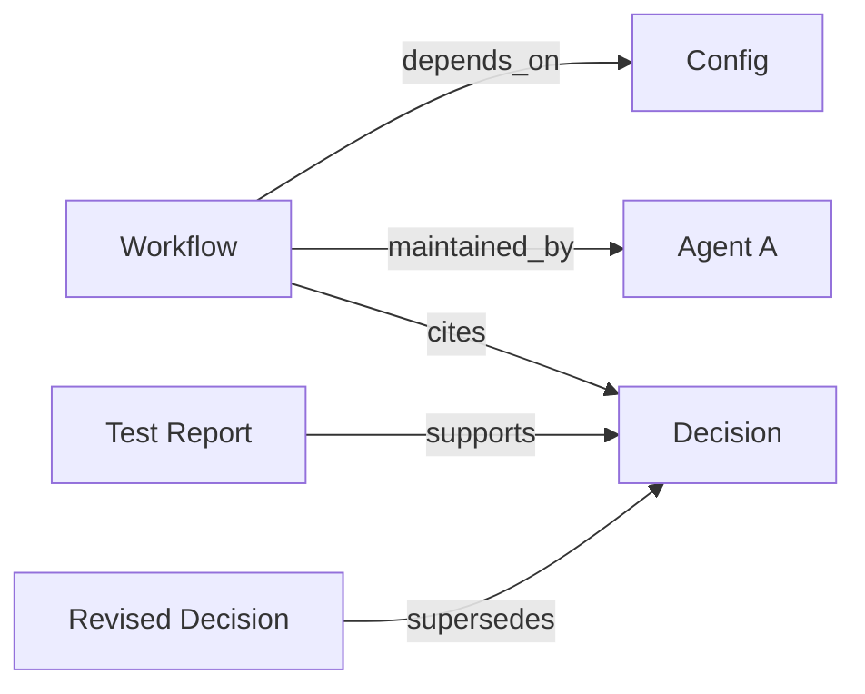

# How the Brain connects context

Work rarely lives in one document. A workflow may depend on a configuration, reflect an earlier decision and have a test report that supports that decision. The Brain connects those records so an agent can recover the surrounding context when the work calls for it. A person can follow the same references and inspect the material behind an answer.

In our constellation, this has made it easier to recover the decisions, dependencies and evidence an agent needs without asking every conversation to hold the whole system.

## Nodes, edges and predicates

Each indexed record is a **node**. A directed **edge** connects two nodes through a named relationship, called a **predicate**. The direction matters: `(Workflow, maintained_by, Agent A)` says the agent maintains the workflow.

This small, invented graph shows the idea:

Someone asking about the workflow might first find its record, then follow relationships to the configuration, its steward and the decision. A second hop from the decision can bring the test report and revised decision into view. The query can explore an edge from either end while retaining its directed meaning.

| Predicate | What the relationship expresses | Why it can help |
| --- | --- | --- |
| `depends_on` | A component or piece of work relies on another. | Recover a dependency before changing or running something. |
| `maintained_by` | A record has a steward. | Identify the agent associated with the work. |
| `cites` | A record references another source. | Follow a decision back to the material it references. |
| `supports` | A record is asserted to support another. | Bring supporting material into the same context. |
| `supersedes` | A record replaces an earlier one. | Discover a later decision that may change what should happen. |

These are actual vocabulary names; the documents and agents in the example are invented.

## A worked question

Consider: **“What changed before this workflow can run?”**

A workflow match is a starting point. Its dependency can reveal the configuration involved; its citation can recover the earlier decision; a relationship to a revised decision can reveal why that guidance changed. The stewardship edge identifies the associated agent. With suitable indexed records and query settings, the pack can bring those pieces together for inspection.

This is the practical meaning of getting context to the right agent at the right time: the agent asking the question has a route back to the relevant work and its history. The Brain does not automatically assign that work, determine that every record is current, or guarantee that this exact set of records will fit a particular query.

## A question becomes a context pack

The Brain starts with a topic or exact identity and identifies candidate records. Within its configured capacity and project filters, it can expand along related edges for a limited number of hops. It then ranks candidates using signals such as relevance, authority, ownership and time.

An approximate token budget guides selection of node text. Headers, relationship lines and separately returned source paths can add to the returned size; this is not a hard cap on the entire serialized response. File paths, where present, let a person or agent inspect the indexed source. They are not a complete explanation of every ranking decision.

Owner preference helps surface material relevant to the agent doing the work. A strict owner option narrows seed selection, though expanded neighbors can have other owners. Temporal filters and historical intent help distinguish a request about current guidance from one about earlier decisions. A weak match may return a low-confidence result.

Scope behavior depends on configured admission. Default business queries can include unclassified indexed sources; explicit project and personal queries use configured admission rules. Neither an owner label nor a relationship authenticates a caller. Deployers need to establish their own trusted calling environment and access controls.

## The vocabulary has rules

The [machine-readable ontology](../canon/0007_ONTOLOGY.yaml) covers structure, reasoning, operations, code, runtime, external references and session history.

Some pairs have a declared inverse: `cites` and `cited_by`, for example. Declaring an inverse describes the vocabulary; it does not prove that both directions have been stored for every relationship.

The ontology declares transitivity for `part_of`, `contains`, `owned_by` and `owns`. It does not declare every relationship transitive. Endpoint guidance lives separately in the validator: `maintained_by`, for example, points to the agent family. These family checks report warnings rather than guarantee correct relationships.

The ontology includes active and retired names. A declared name is not proof that it is active, present in the index or reachable for a query. Unresolved endpoints and admission affect walkability. The ordinary walk excludes semantic-similarity, co-occurrence and synonym edges by default; explicit predicate selection changes that filter.

## Knowledge and memory retain different jobs

**Knowledge** provides reference and understanding: methods, standards, explanations and material worth learning from.

**Memory** preserves decisions and experience: what happened, what was learned and what should carry forward.

**The Brain** indexes and connects material for retrieval. The relevant decision, its dependencies and supporting evidence can travel together instead of being rediscovered one file at a time. Knowledge and memory remain inspectable sources; neither becomes reliable merely because of its folder name.

## Traceability is not proof

An edge may record its asserter, evidence span, weight and confidence. These make a relationship more inspectable, but a label or score is not independent evidence of truth. Semantic similarity can suggest related material; it does not establish causation.

The engine stores generic edge metadata and checks indexed source versions during retrieval. A generic edge does not automatically carry a version binding for every supporting input. Source references make claims traceable, not necessarily correct or current. Files changing on disk still need re-ingestion before the index reflects the change.

This explanation describes inspected source behavior and our stated experience. It does not claim measured retrieval quality, perfect routing or authenticated multi-user isolation.
